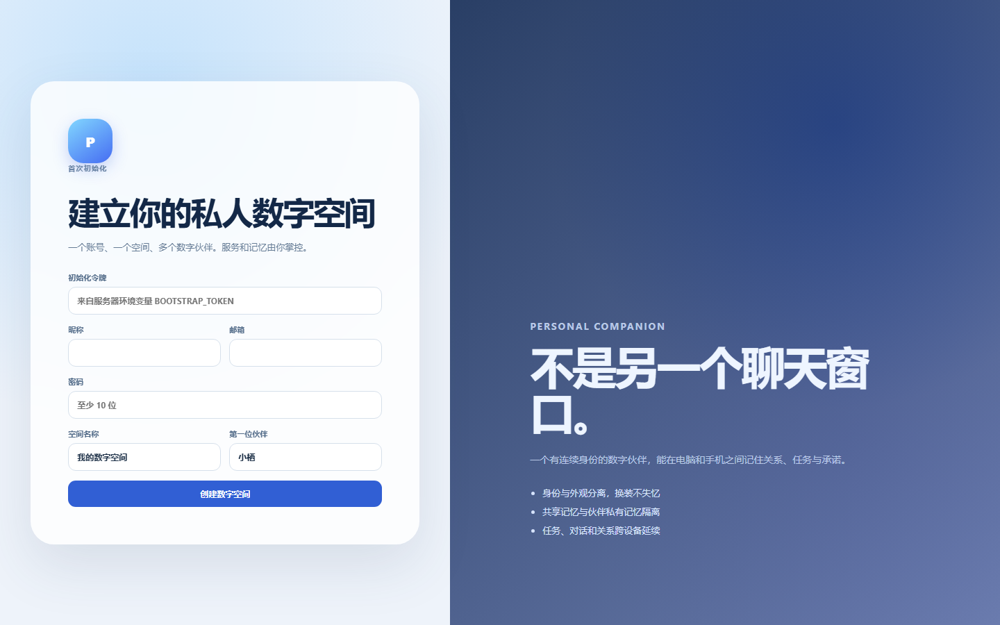

# Personal Digital Companion

> 一个私人数字空间、多个持续存在的数字伙伴、跨设备共享记忆与任务，以及可替换的角色身体。



本项目不是“另一个聊天窗口”，也不把桌宠皮肤当作助手身份。核心目标是构建一个 **JARVIS-lite / F.R.I.D.A.Y.-lite** 式的个人数字伙伴平台：

- 每个数字伙伴有持久身份、人格、记忆和工具权限。
- 换装、换造型或换 Avatar 不会丢失关系和历史。
- 电脑、手机和 Web 可以连接同一个私人 Workspace。
- 不同伙伴拥有独立会话和私有记忆，也可以读取用户授权的共享记忆。
- 任务和主动反馈由可持久化、可审计的服务层管理。

旧版桌宠应用保存在 Git 标签 `legacy-aidesktoppet-v1`。

## 当前阶段

项目处于 **早期基础版本**，已具备一个可运行的单人 Workspace：

- 服务端 SQLite 持久化、初始化令牌和 JWT 登录。
- Windows 桌面浏览器与手机浏览器多设备登录。
- 多个数字伙伴创建和切换。
- 独立对话历史。
- 个人共享、伙伴私有和项目记忆作用域。
- 任务创建和完成。
- 外观/服装/颜色切换，伙伴身份与记忆不变。
- `mock` 模型模式，无模型 Key 也能体验完整流程。
- OpenAI-compatible 模型接口。
- Docker 单容器部署。

这不是最终产品。多设备实时同步、自动记忆提取、Electron 桌宠壳、语音、工具运行时和智能家居仍在路线图中。

## 为什么值得参与

模型、Agent 框架、工作流和记忆库正在快速商品化。真正稀缺的是把这些能力组织成持续、可信、可拥有、跨设备存在的个人数字伙伴。

我们希望在以下方向形成开放实现：

- 数字伙伴身份与外观分离。
- 共享记忆、私有记忆和设备私有上下文。
- 多伙伴之间的权限与关系隔离。
- 云端任务与设备端感知识别。
- 可替换的人格、模型、声音和动作资产。
- 有边界、不操纵依赖的情绪陪伴。

详见 [JARVIS / F.R.I.D.A.Y. 可行性研究](docs/FEASIBILITY_JARVIS_ARCHETYPE_2026-10-28.md)。

## 快速开始

要求 Node.js 22.12+、pnpm 11+。

```powershell
corepack enable
pnpm install
Copy-Item .env.example .env
```

修改 `.env`：

```dotenv
BOOTSTRAP_TOKEN=替换为至少 16 位的随机值
JWT_SECRET=替换为至少 32 位的随机值
DATA_DIR=./data
MODEL_PROVIDER=mock
```

启动：

```powershell
pnpm dev
```

- Web：<http://127.0.0.1:5173>
- API：<http://127.0.0.1:8787>

首次打开 Web 时，用 `.env` 中的 `BOOTSTRAP_TOKEN` 创建 Workspace。之后可在另一台设备用同一邮箱和密码登录，共享伙伴、记忆和任务。

## 接入模型

```dotenv
MODEL_PROVIDER=openai-compatible
MODEL_BASE_URL=https://api.deepseek.com
MODEL_NAME=deepseek-chat
MODEL_API_KEY=你的服务端 Key
```

不要把真实 Key 提交到仓库。Web 客户端永远不直接持有模型 Key。

## Docker 部署

```powershell
$env:BOOTSTRAP_TOKEN="替换为随机值"
$env:JWT_SECRET="替换为至少32位随机值"
$env:MODEL_PROVIDER="mock"
docker compose up -d --build
```

浏览器访问 `http://服务器地址:8787` 前，需要配置反向代理把 Web 静态资源和 API 暴露在同一域名下，或分别部署 `apps/web/dist` 与 API。

当前 Compose 单容器方案以个人或家庭部署为目标。公开多用户 SaaS 需要 PostgreSQL、限流、审计、租户隔离和独立密钥管理。

## 项目结构

```text
apps/api             Fastify API、SQLite、模型适配
apps/web             React 响应式 Web 客户端
packages/contracts   共享 Zod 契约和 TypeScript 类型
docs                 产品、架构、安全与研究
openspec             需求提案、设计和任务
```

## 开发验证

```powershell
pnpm check
pnpm test
pnpm build
```

## 路线图

- V1：个人 Workspace、多伙伴、记忆作用域、任务、多设备登录。
- V1.1：流式模型、自动记忆提取、语音、通知。
- V1.2：Electron 桌宠、PWA、离线和增量同步。
- V1.5：MCP / Tool Runtime、Home Assistant、低风险智能场景。
- V2：多视图和动作包、2D/3D 适配、高风险智能家居审批。

详见 [ROADMAP.md](ROADMAP.md)。

## 参与贡献

欢迎通过 Issue、Discussion 和 Pull Request 参与：

- 提交前阅读 [CONTRIBUTING.md](CONTRIBUTING.md)。
- 功能变化先讨论问题和使用场景。
- 架构性变化先补 OpenSpec。
- 安全漏洞请使用 GitHub Private Vulnerability Reporting。

## 安全与隐私

- `local_only` 和设备私有上下文不得发送到云端模型。
- 密码强哈希；JWT Secret 和初始化令牌只从环境变量读取。
- 模型、邮件、网页、文件与 Connector 响应都是不可信输入。
- 高风险动作必须经过确认、审计和超时控制。
- 智能家居安全联锁不得由 LLM 临时决定。

详见 [SECURITY.md](SECURITY.md)。

## License

[MIT](LICENSE)
