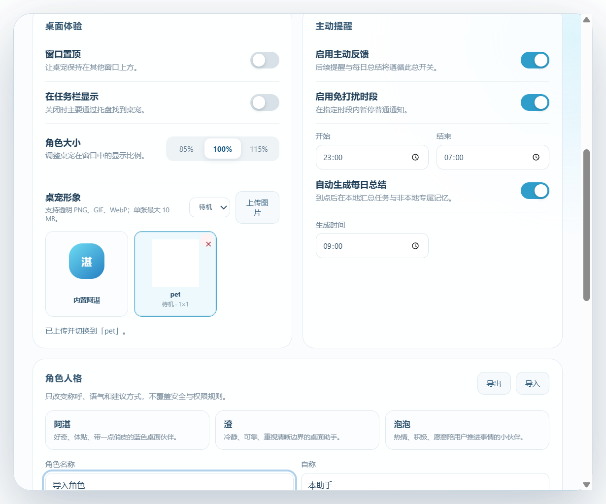
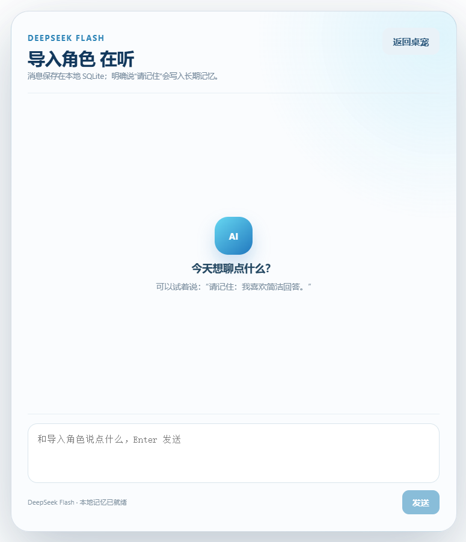
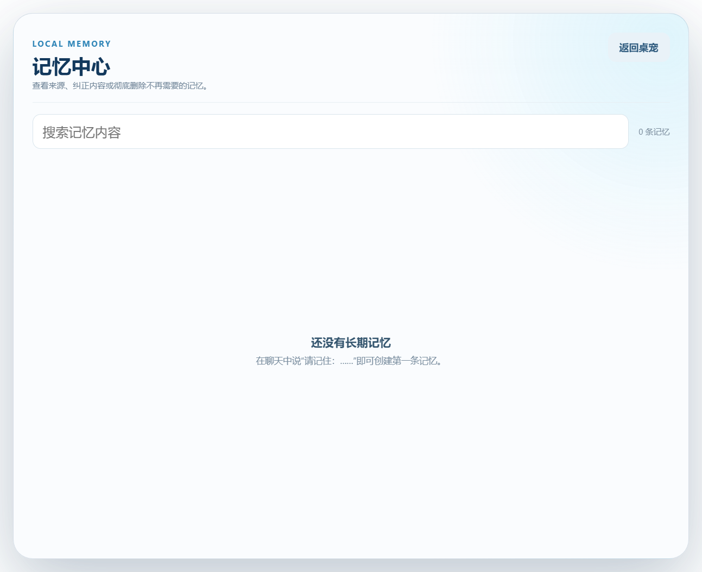
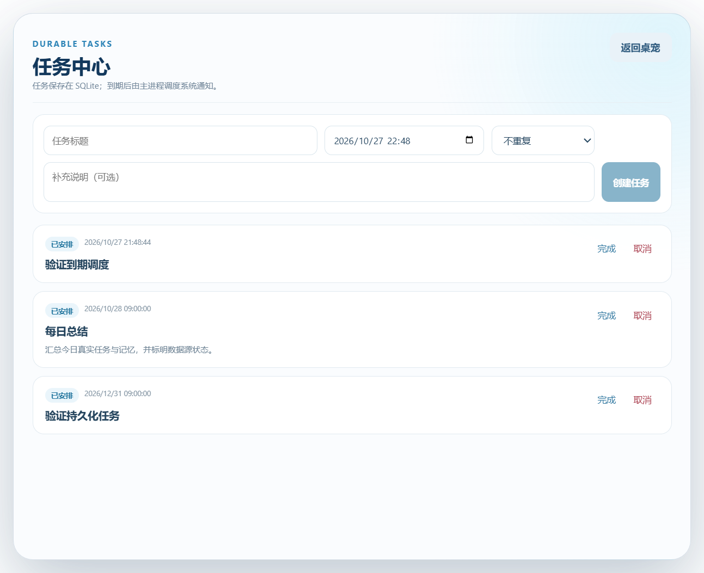
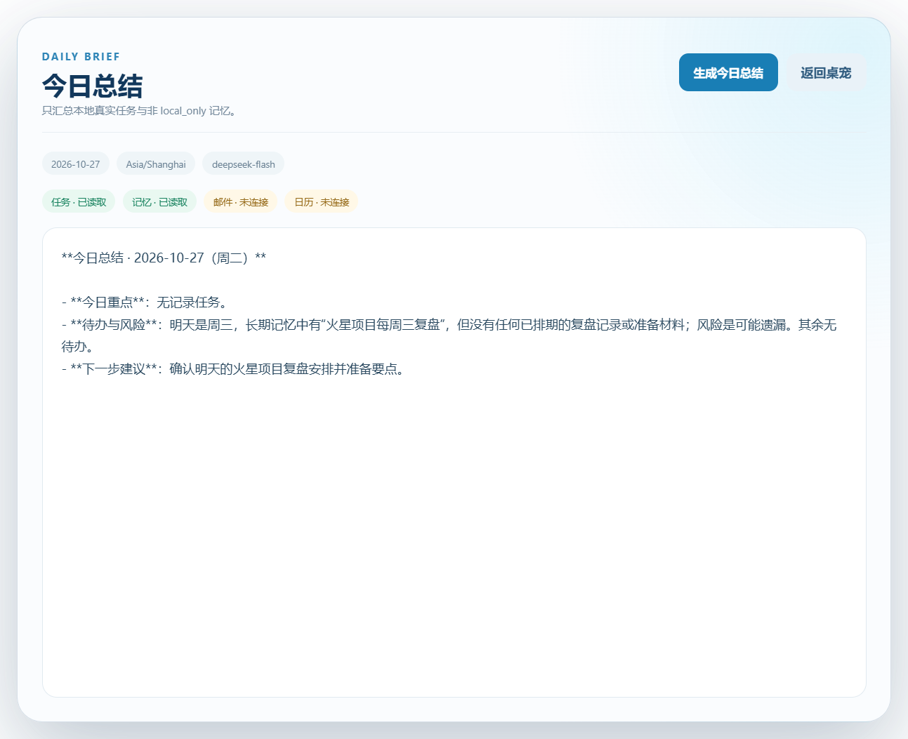
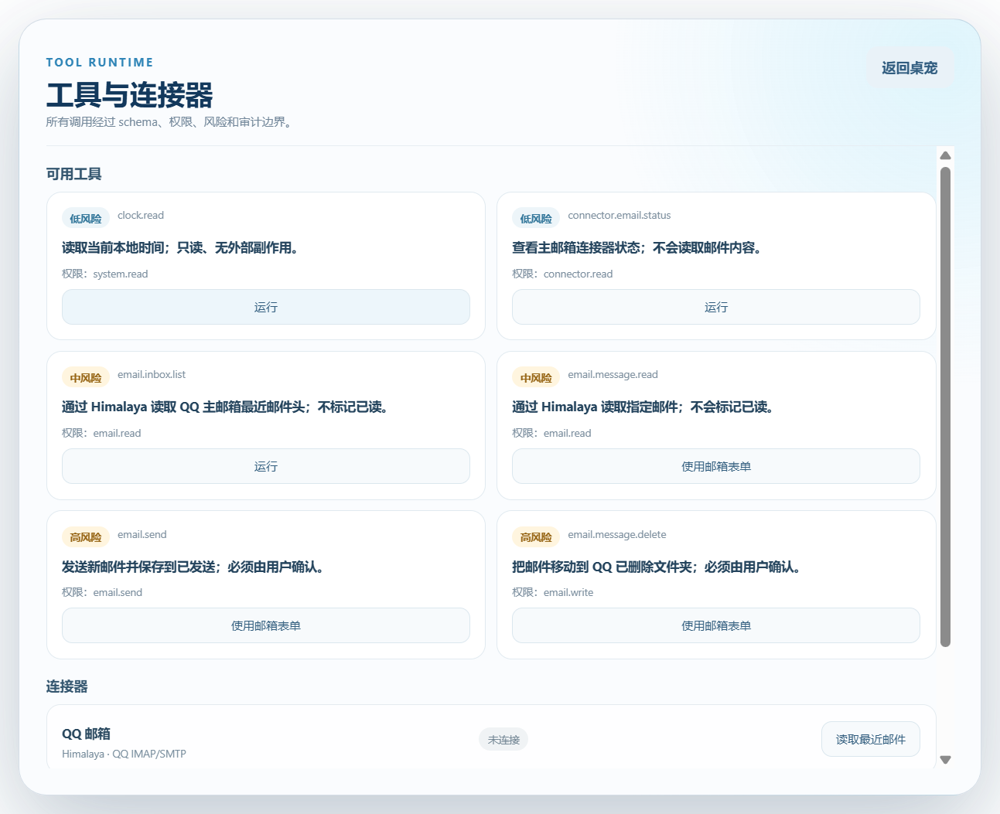
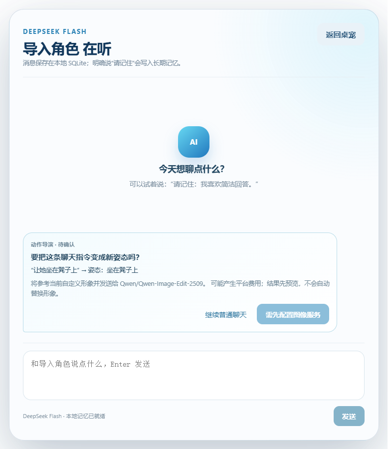
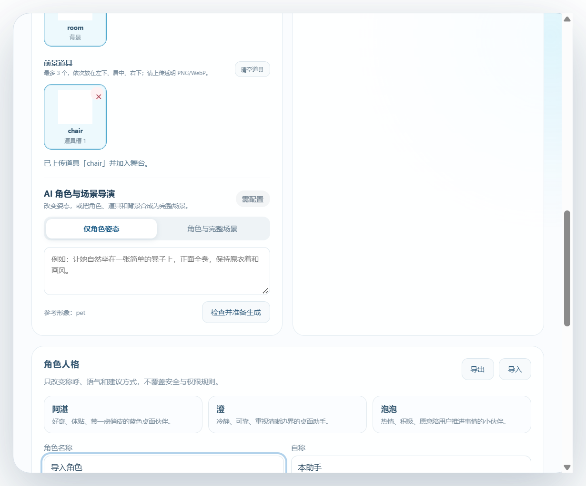

# AI Desktop Pet

Windows 优先的 AI 桌宠项目。桌宠是用户入口，核心能力包括 AI 对话、可审计的长期记忆、持久化任务调度、主动反馈和受权限控制的外部连接器。

## 当前状态

**P12 角色舞台资产已实现：默认透明，可分层组合背景/道具，或用 AI 生成完整场景。**

已实现：

- Electron + React + TypeScript + pnpm workspace。
- 透明无边框桌宠窗口、拖动区域、窗口位置恢复和系统托盘。
- 隔离 preload、白名单 IPC、严格设置 schema 和原子 JSON 持久化。
- 基础设置页：窗口置顶、任务栏显示、角色大小、主动提醒、免打扰和开机启动偏好。
- SQLite 版本化迁移、对话历史与消息持久化。
- Electron `safeStorage` 加密保存 DeepSeek API Key。
- `deepseek-flash` 流式对话、停止生成和错误状态。
- 明确“请记住”消息写入长期记忆，并参与后续上下文检索。
- 记忆中心支持搜索、编辑、删除和来源数量查看。
- 一次性任务支持持久化创建、完成、取消、租约恢复和幂等通知。
- 到期任务由主进程调度并调用 Windows 系统通知。
- SiliconFlow BGE-M3 语义检索、1024 维本地向量和关键词混合排序。
- Embedding 不可用时自动回退 FTS5，不阻塞对话。
- 今日总结只使用本地任务和非 `local_only` 记忆，并明确标记未连接数据源。
- 支持每天、工作日和每周重复任务，按 IANA 时区计算下一次发生时间。
- 每日总结按设置时间作为持久化 maintenance task 自动执行。
- 工具调用统一经过 schema、scope、风险、超时、取消和审计。
- 高风险邮件发送和移至已删除必须经过用户确认。
- Himalaya v2.1.0 已接入 QQ IMAP/SMTP；收件箱只读列表经过真实账号验证。
- QQ 授权码已迁移到 Windows Credential Locker，Himalaya 通过 `password.command` 读取。
- Connector 状态持久化；邮件正文不会未经用户操作自动读取。
- 人格支持预设和自定义，可配置名称、自称、称呼、性格、语气、长度、边界和主动性。
- 人格设置支持 JSON 导入导出，下一轮对话立即生效。
- 固定安全底座不可被人格配置覆盖。
- 工具中心增加持久化审计记录和筛选，显示动作、结果、原因与 trace ID。
- 支持上传 PNG/GIF/WebP 桌宠形象，持久化、预览、切换和删除。
- 图片资产校验真实格式、10 MiB 大小上限和 4096×4096 尺寸上限。
- 角色资产预留 front/left/right/back 与状态视图，为多视图和 3D 演进提供统一入口。
- 支持在聊天中说“让她坐在凳子上”，或在设置页输入姿态描述。
- 动作指令先显示参考角色、模型、云端上传与可能费用，确认后才调用硅基流动 `Qwen/Qwen-Image-Edit-2509`。
- AI 生成结果保存为新 `ai_generated` 资产，记录源角色、提示词、模型和时间；不覆盖原图。
- 生成结果先预览，用户点击“设为桌宠”后才切换，可随时切回原图或历史姿态。
- 生图结果立即下载并验证公网 HTTPS、图片格式、尺寸和 10 MiB 上限；支持 120 秒超时和取消。
- 桌宠舞台默认保持透明，不自动添加矩形背景。
- 可分别上传背景与最多 3 个透明前景道具，按背景、道具、角色顺序分层显示。
- AI 支持“仅角色姿态”和“角色 + 道具 + 背景完整场景”；完整场景保存为独立 `scene` 资产。
- 选择完整场景时自动让位独立背景与道具，避免重复叠加；删除任一图层后回退到剩余图层或透明舞台。
- 未配置模型时的明确基础可用状态。
- 设置、数据库、记忆、Assistant Core、SSE、任务调度和 Electron 端到端测试。

尚未实现：

- 日历 Connector
- 模型 function calling
- 邮件发送和删除的真实副作用验收
- 多视图角色包编辑器、连续动作帧、2D 骨骼和 3D 渲染器
- 签名的 Windows 安装包



















## 文档入口

- [产品需求](./docs/PRD.md)
- [系统架构](./docs/ARCHITECTURE.md)
- [长期记忆](./docs/MEMORY_SYSTEM.md)
- [任务引擎](./docs/TASK_ENGINE.md)
- [数据库设计](./docs/DATABASE_API_DESIGN.md)
- [API 契约](./docs/API_CONTRACTS.md)
- [实施计划](./docs/CODEX_IMPLEMENTATION_PLAN.md)
- [安全基线](./docs/SECURITY.md)
- [视频技术借鉴](./docs/Windows_AI桌宠_视频技术借鉴与长期记忆架构方案.md)
- [视频读取结果](./docs/VIDEO_FINDINGS.md)
- [依赖与许可证](./docs/DEPENDENCIES.md)
- [角色展现与 3D 演进](./docs/CHARACTER_RUNTIME.md)

## 本地运行

```powershell
pnpm install
pnpm dev
```

验证：

```powershell
pnpm check
pnpm test
pnpm test:e2e
pnpm build
```

## 里程碑

首版目标是 Windows 10 22H2 x64 与 Windows 11 x64 上的 2D 桌宠，基础桌宠不依赖模型、Agent runtime 或 QQ/NapCat/AstrBot 才能启动。ARM64 只有在真实安装包和运行验证完成后才能纳入支持矩阵。

下一阶段进入 P12：接入模型 function calling、日历 Connector，并补邮件发送/删除的真实副作用验收。角色侧将把单张姿态候选扩展为动作关键帧、表情包和多视图资产，再评估 2D 骨骼与 GLB 3D；多视图图片本身不等于可自由动画的 3D 模型。DeepSeek 与 SiliconFlow 的 API Key 都只能通过设置页写入 Windows DPAPI 加密文件；QQ 授权码由 Windows Credential Locker 提供。

## 仓库约束

- 需求变化先写 OpenSpec 提案、设计和任务清单。
- 外部输入、模型输出和连接器响应均按不可信数据处理。
- `local_only` 数据不得发送到云端模型。
- 高风险外部动作必须展示目标与影响并取得用户确认。
- 没有测试、构建或运行证据时，不得在文档或提交说明中声明功能“已完成”或“通过”。
